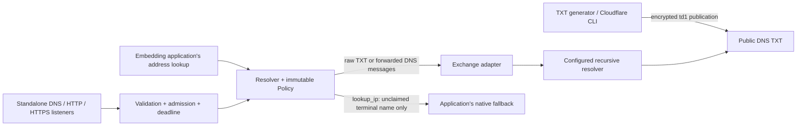
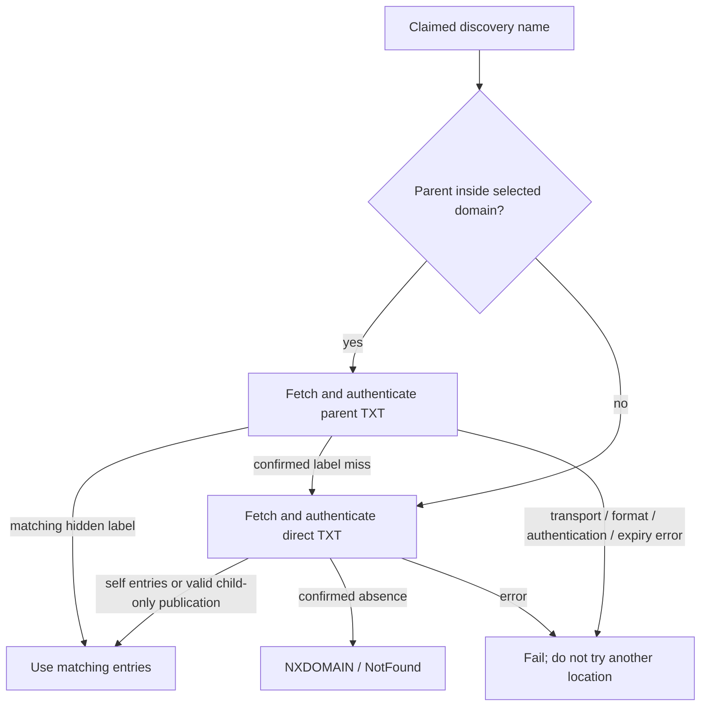

# Tendns Design

This document describes the implemented 0.2 library and standalone binary, not a
proposal. The [README](README.md) covers installation and operation;
[API documentation](https://docs.rs/tendns) describes the Rust interfaces;
[test coverage](https://github.com/cfal/tendns/blob/main/tests/README.md) maps the
guarantees below to regression tests.

Contents: [architecture](#architecture-and-feature-boundary),
[resolution](#discovery-resolution), [embedding](#embedded-resolver-contracts),
[wire format](#the-td1-wire-format), [caching](#cache-and-time-model),
[operations](#standalone-server-and-publishing),
[security](#design-choices-and-security-limits).

## Purpose and Rationale

Tendns provides dynamic DNS discovery without publishing endpoint addresses as
plaintext A/AAAA records. An operator stores an authenticated, encrypted
publication in ordinary DNS TXT records. A client with the discovery key resolves
that publication into addresses or aliases. Existing DNS hosting and recursive
resolvers carry the data; no custom authoritative server or discovery API is
required. Updating an endpoint means replacing its encrypted publication.

Three use cases motivate the design:

1. **Dynamic discovery with payload privacy.** A stable name can follow changing
   IPv4/IPv6 addresses without exposing those values directly in public DNS.
   Publications expire, so operators must refresh them even when addresses have
   not changed. Tendns provides generation and Cloudflare update commands, not
   an address-change detector or renewal scheduler.
2. **A choice of public or private subdomain labels.** A public owner such as
   `nas.example.com` can be useful for inventory, query analytics, or tracking an
   endpoint under a recognizable name. Alternatively, the label `nas` can live
   inside ciphertext published at `example.com`. Both modes encrypt the payload;
   "public" describes the DNS name, not a public decryption key or plaintext
   address record. Privacy of a hidden label is conditional on a successful
   parent lookup, as described below.
3. **Exact internal addresses behind suffix-based routing.** With
   `via-vpn.internal` configured as a hex zone,
   `0a14001e.via-vpn.internal` resolves to `10.20.0.30`. A VPN or proxy application
   can route that suffix through a particular tunnel while the first label
   selects the exact destination. Tendns supplies the address; the application
   supplies the routing rule and must retain the hostname for that decision.
   Hex labels are an address notation, not encryption.

The library split lets a host such as Shoes use the same discovery behavior
inside its existing resolver and routing stack, without running another DNS
listener or replacing resolution of unrelated names.

Non-goals are service authentication, access revocation, anonymity, port
discovery, configuring VPN/WireGuard endpoints, automatic DNS updates, persistent
anti-replay state, and multi-writer coordination. There is no DoT or DNSCrypt
listener, HTTP/3 listener, or provider-independent control plane.

## Architecture and Feature Boundary



The default `cli` Cargo feature enables the binary and its supporting modules.
`tendns = { version = "0.2", default-features = false }` builds the embeddable core.
The binary target requires `cli`; disabling it does not produce a reduced server.
Cargo features are additive: another dependency enabling `cli` can bring the
standalone dependency graph back into the application's build.

| Component | Responsibility | Availability |
| --- | --- | --- |
| [`policy`](https://github.com/cfal/tendns/blob/main/src/policy.rs) | Validated namespaces, keys, TTL cap, cache capacity | Core |
| [`protocol`](https://github.com/cfal/tendns/blob/main/src/protocol.rs) | `td1` encoding, encryption, authentication, freshness | Core |
| [`names`](https://github.com/cfal/tendns/blob/main/src/names.rs) | Hostname canonicalization, hidden labels, owner wire names | Core |
| [`resolver`](https://github.com/cfal/tendns/blob/main/src/resolver.rs) | Parent/direct lookup, synthesis, aliases, publication cache | Core |
| [`upstream::Exchange`](https://github.com/cfal/tendns/blob/main/src/upstream.rs) | Host-supplied raw DNS transport contract | Core |
| [`deadline`](https://github.com/cfal/tendns/blob/main/src/deadline.rs) | Shared absolute-deadline enforcement and `TimeoutError` | Core; helper module private |
| [`config`](https://github.com/cfal/tendns/blob/main/src/config.rs) | TOML and startup options, construction of `Policy` | `cli` |
| [`upstream::Forwarder`](https://github.com/cfal/tendns/blob/main/src/upstream/forwarder.rs) | Built-in UDP/TCP and DoH transport | `cli` |
| [`server`](https://github.com/cfal/tendns/blob/main/src/server.rs), [`server::doh`](https://github.com/cfal/tendns/blob/main/src/server/doh.rs) | Listeners, bearer auth, TLS, HTTP formatting, shutdown | `cli` |
| [`cloudflare`](https://github.com/cfal/tendns/blob/main/src/cloudflare.rs), [`main`](https://github.com/cfal/tendns/blob/main/src/main.rs) | Publication management and command dispatch | `cli` |

The core does not open sockets, read TOML or credential files, create a runtime,
or call the Cloudflare API. It still uses Tokio synchronization/timers and native
AWS-LC cryptography; it is not a `no_std`, runtime-independent, or pure-Rust-only
build. Async resolver calls need a Tokio runtime with time enabled. Applications
provide their own runtime, transport, configuration, secret storage, admission
limits, and destination filtering.

`hickory_proto` is re-exported by the crate so adapters can use exactly the DNS
message/name types in the public API. Hosts using a separate Hickory dependency
must ensure compatible crate identity, not merely similar type names.

## Policy and Namespace Ownership

`Policy::new(discovery, hex_zones, ttl, cache_capacity)` validates and stores an
immutable policy. Each `Discovery` contains a DNS domain and an `Arc<Secret>`.
Domains and configured targets use 1-63-byte ASCII letter/digit/hyphen labels,
without leading/trailing hyphens; supply internationalized names as Punycode.
This is deliberately narrower than arbitrary DNS names. Policy construction
lowercases names, makes them absolute,
rejects duplicates and invalid limits, and sorts discovery domains most-specific
first. Nested discovery domains may use different keys. Hex zones cannot overlap
one another or any discovery domain.

`Policy::claims(name)` tests the supplied labels against those namespaces. It
does not validate that a claimed name actually exists, expand search domains, or
interpret OS/NSS aliases. A claimed but missing name is still protected from
ordinary address fallback.

Create one `Resolver` for each immutable policy and raw-upstream policy. Its cache
belongs to that pair. Do not reuse it across split-horizon DNS views just because
the keys are identical. Construct a new policy/resolver when keys or upstream
semantics change; there is no in-place key rotation or shared global cache.

## Discovery Resolution

For a query for `nas.example.com`, select the most-specific configured discovery
domain containing that name. Then:

1. If its immediate parent is inside that same discovery domain, fetch TXT at
   `example.com`, authenticate the publications, and look for entries with hidden
   label `nas`.
2. Only after a confirmed miss for that label, fetch TXT at `nas.example.com` and
   look for entries with an empty hidden label, meaning the public TXT owner.
3. If both locations miss, the name is absent. Never query public A/AAAA as a
   substitute for a missing or broken discovery entry.



Only one hidden label is supported, not a dotted private path. There is no
recursive ancestor search. For nested policies `example.com` and
`lab.example.com`, a lookup at the inner apex does not inspect the outer key's
parent publications. The same boundary governs CLI placement.

Claimed names use local discovery/hex semantics for every query type, not just
address queries. Only A, AAAA, and CNAME are synthesized: ordinary public TXT,
MX, NS, and SOA records at that name are not passed through. In particular,
`dig TXT example.com` through a resolver claiming `example.com` does not expose
its publications; those are fetched internally through `Exchange`. A local
CNAME can still lead outside the namespaces and return public records there.

Parent precedence is independent of query type. If the parent supplies only A
for `nas`, an AAAA query returns NODATA; it does not inspect a direct AAAA record.
Parent and direct lookups therefore must not run speculatively in parallel.
An owner with a valid child-only publication exists but has no self records, so
it returns NODATA rather than NXDOMAIN. The hex-zone apex behaves the same way.

The TXT collector accepts non-truncated NOERROR or NXDOMAIN responses, rejects
same-owner CNAME indirection, and considers IN-class TXT answers at the exact
owner. Normal TXT data is ignored after resource-limit accounting. Reserved
prefixes are recognized when the bytes before the first dot (or the entire value
if there is no dot) are exactly `td` followed by one or more ASCII digits.
Thus `td2.x`, `td01.x`, and even `td9` fail rather than being ignored; only `td1.`
is supported. An encrypted answer inside an NXDOMAIN response is contradictory
and rejected.

One TXT RR may contain several DNS character-strings. Concatenate those strings
without separators before decrypting. Never concatenate distinct TXT RRs.
Multiple encrypted RRs at one owner are authenticated independently and combined;
duplicate entries across publications are deduplicated, while CNAME/address
conflicts fail. Within each publication, a CNAME must be the only entry for its
hostname, so even duplicate CNAMEs in one publication are rejected. The combined
publication uses the earliest issuance and expiry and the smallest encrypted-RR
TTL. Timestamps do not choose a winning publication. One bad or expired encrypted
sibling fails the owner even when another publication has the desired entry:
the bad value might also contain that hidden label. This is a privacy boundary,
not a best-effort merge.

Aliases are exclusive per resulting hostname. Packet queries for CNAME or ANY
return the local alias without following it; other query types follow it.
Address lookups also follow aliases. Loop detection and a maximum of 16 visited
names bound both paths. Local aliases may lead to another private domain, a hex
name, or a public target. Public targets use the packet transport or the host's
address fallback according to the API being called.

### What Hidden Labels Protect

A successful parent lookup avoids querying the hidden child name upstream.
Confirmed absence permits a direct lookup, which reveals that name. Public TXT
owners, ciphertext sizes, query/update timing, and the endpoint's subsequent
traffic remain observable. Lower TTLs and more frequent publication improve
freshness but also reveal more update activity. Hidden labels are a selectable
privacy improvement, not a guarantee that a name is never disclosed.

"Confirmed" means an accepted DNS response, not cryptographically authenticated
absence. Tendns does not require an upstream DNSSEC AD bit. An attacker able to
make a parent appear absent can induce the direct lookup and expose the child
label; publication authentication does not authenticate missing DNS data.

### Hexadecimal Address Names

A hex zone synthesizes A for exactly one eight-character ASCII hexadecimal label,
case insensitive, interpreted as four IPv4 octets in network order. For example,
`0a14001e.via-vpn.internal` selects `10.20.0.30`. No TXT fetch or key is involved.
All IPv4 values are allowed, including private, loopback, and unspecified values.
A and ANY queries return the synthesized A record; other permitted query types
at a valid hex name return NODATA. Malformed names inside the zone return
NXDOMAIN. Embedders must apply their own address-deny rules and routing policy.
No IPv6 hexadecimal synthesis is implemented.

## Embedded Resolver Contracts

There are two entry points, serving different callers:

| API | Unclaimed names | Result and failure handling |
| --- | --- | --- |
| `answer` / `answer_with_deadline` | Raw DNS through `Exchange` | DNS `Message`; claimed names use local semantics for every query type (local aliases may lead outside); local absence becomes NXDOMAIN or empty NOERROR; other failures return `anyhow::Error` |
| `lookup_ip` | Application-provided async fallback | Deduplicated `Vec<IpAddr>`; negative results use `LookupError`; other failures return `anyhow::Error` |

Packet-serving callers should apply `resolver::validate_request` first. It checks
opcode Query, exactly one question, IN class, no AXFR/IXFR, EDNS version zero,
and an empty `Message::signature`. Hickory 0.26.3 populates that field from wire
TSIG only with its DNSSEC feature enabled. Neither tendns build enables that
feature; unless the host's dependency graph does, decoded TSIG remains in
additionals and is not refused by this check. The validator also does not check
the QR bit or reject SIG(0).
Packet-serving embedders must add the checks they need, including explicit
signature-record inspection if they intend to refuse signed requests regardless
of Hickory features. The helper returns a DNS response code, not a reply.
The standalone `Handler` performs that validation and converts resolution errors
or overload into SERVFAIL. The low-level library does not silently apply the
server's admission policy or truncate returned messages to a UDP payload limit.
`resolver::local_response` builds an empty response for caller-selected statuses.

`Exchange` must use the host's raw DNS layer, not recursively call the tendns
wrapper. It must associate responses with requests and complete UDP truncation
fallback before returning. Return complete DNS messages, preserving RCODE, TTLs,
TXT RR/chunk boundaries, and negative-answer SOA records. NXDOMAIN is a DNS
response, not a transport error. Only exact-owner IN TXT answers are collected;
additionals are not substitutes. Wrong response association can look like an
absent parent publication and cause a child-name disclosure.

Calls can be concurrent, and deadline expiration or caller cancellation can drop
an exchange future. Its default `exchange_with_deadline` wraps `exchange`
with the caller's deadline. Override it when the underlying transport already
accepts an absolute deadline, keeping the same bound rather than resetting it
for each TXT owner, retry, or CNAME target.

`lookup_ip(name, strategy, deadline, fallback)` calls the fallback at most once,
only when resolution reaches a name outside all configured namespaces. Missing,
invalid, and expired private entries never invoke it. Unclaimed input names are
passed through unchanged, including relative spelling; local claimed names are
normalized. A private CNAME's external target is absolute.

| `IpStrategy` | Selection from available addresses |
| --- | --- |
| `Ipv4Only` / `Ipv6Only` | Keep only that family |
| `Ipv4ThenIpv6` (default) | Keep IPv4 if present, otherwise IPv6 |
| `Ipv6ThenIpv4` | Keep IPv6 if present, otherwise IPv4 |
| `Ipv4AndIpv6` | Keep both families |

These strategies filter results; they do not implement connection racing or
Happy Eyeballs. Fallback results are filtered too. The host must return the
address families it wants tendns to choose from. Result order is retained while
duplicates are removed; the API does not promise a DNS RRset ordering policy.

`LookupError::NotFound` means a private/hex name is absent. `NoData` means the
final result has no addresses for the selected family, including an empty or
incompatible-family result from the public fallback. Authentication and transport
failures remain errors, not negative answers. Tendns-enforced deadlines can be
recognized with `error.is::<tendns::TimeoutError>()`; custom transport and native
fallback errors may have their own types.

Use `answer_with_deadline` or `lookup_ip` with one absolute Tokio `Instant` for
the whole operation. The bound includes cache-lock waits, TXT requests, local
aliases, and public fallback. Already-expired deadlines do not start work, and
completion is checked again against the deadline. Cancellation drops the pending
future; transports must manage their own cancellation-safe resources. Tokio
timeouts are cooperative and cannot preempt blocking work. `answer` deliberately
has no overall timeout.

For strict namespace protection, pass absolute names and prevent native search
lists or aliases from expanding an unclaimed name into a protected namespace.
For example, native resolution of `nas` could otherwise search
`nas.example.com` outside tendns. This expansion is opaque to the library.
Likewise, the host must not retry private failures through its ordinary resolver.
Public alias chains returned by an upstream or followed inside native fallback
are opaque to tendns: their targets are not re-intercepted as private queries.
The no-public-fallback rule covers names tendns evaluates itself, including local
private CNAME targets, not arbitrary aliases inside another resolver.

The address API returns no TTL. Do not add a fixed-lifetime outer address cache
that could outlive authenticated expiry. Reuse the resolver's publication cache
instead. The adapter/lookup example in
[the crate documentation](https://github.com/cfal/tendns/blob/main/src/lib.rs) and
[`tests/resolution/lookup.rs`](https://github.com/cfal/tendns/blob/main/tests/resolution/lookup.rs) show the embedding
boundary and deadline/fallback behavior without a built-in network transport.

## The td1 Wire Format

### Envelope and Key Derivation

```text
td1.<unpadded-base64url(nonce[12] || ciphertext || authentication_tag[16])>
```

The cipher is AES-256-GCM-SIV through AWS-LC. Every encryption generates a fresh
random 12-byte nonce (IV). The configured secret is 32 random bytes, represented
as unpadded base64url, not a password. The AEAD tag supplies integrity and
authentication; no separate MAC is appended.

For each public TXT owner, derive a 32-byte encryption key using HKDF-SHA256:

```text
owner_wire = lowercase, uncompressed DNS wire name, including the final root zero
PRK = HKDF-Extract(salt = ASCII("tendns/td1"), IKM = configured_secret)
key = HKDF-Expand(PRK, ASCII("aes-256-gcm-siv") || owner_wire, 32)
AAD = ASCII("tendns/td1") || 0x00 || owner_wire
```

The authenticated owner is the public TXT name, not an encrypted child label.
Presentation case and the optional trailing dot do not change it. Moving a blob
to another owner fails authentication even when both domains use the same secret.
Anyone holding that secret can create valid publications; this is not a digital
signature with separate read and write keys.

GCM-SIV reduces the damage of accidental nonce reuse compared with ordinary GCM;
it does not guarantee unique random nonces, prevent replay, or justify deliberate
reuse. There are no durable counters or snapshot-safe publisher epochs.

### Authenticated Plaintext

All integers are unsigned and big-endian. Entries run to the end of the
authenticated plaintext; there is no entry count, sequence number, protobuf,
padding, or overall plaintext-length field.

```text
issued_at:u64                 Unix seconds
expires_at:u64                Unix seconds
entries...

entry:
  type:u8 | subdomain_length:u8 | subdomain_bytes | value

type 0 (A):     value = IPv4[4]
type 1 (AAAA):  value = IPv6[16]
type 2 (CNAME): value = target_length:u16 | absolute_ASCII_target_bytes
```

An empty subdomain means the TXT owner. Otherwise it is one lowercase ASCII
hostname label, at most 63 bytes, with no dots or leading/trailing hyphen.
Address octets use network order. CNAME targets are absolute ASCII presentation
names ending in a dot; the encoder emits lowercase targets. Both the target and
the full name formed by appending a hidden label must fit DNS name limits.

Readers reject unknown entry types, partial fields, empty publications, invalid
names, conflicting aliases, and invalid timestamps. A publication must satisfy
`expires_at > issued_at`, `expires_at > now`, and `issued_at <= now + 60` seconds.
There is no expiry grace period. Structural decoding/encoding alone is not a
freshness check; `protocol::decrypt` authenticates, decodes, and validates time.
`Publication::decode` does not authenticate bytes; `encrypt` validates structure
but does not compare timestamps with the current clock. There is no fixed maximum
validity window: publishers choose the expiry and must manage replay exposure.
The internal administrative update path can open expired authenticated data so
the CLI can refresh it; resolvers always use the strict path.

Timestamps bound validity, not replacement order. A newer publication does not
supersede an older sibling automatically. Publishers must replace or delete old
TXT values explicitly. An older authentic publication can be replayed until its
expiry; no persistent high-water mark is maintained across restarts.

### Resource Bounds

| Bound | Current limit |
| --- | --- |
| Authenticated plaintext per publication | 4096 bytes |
| Entries per publication / combined owner publication | 256 |
| Encoded TXT value accepted by the decoder | 5504 bytes, including prefix |
| Matching IN TXT RRs at one owner | 16, including ordinary TXT |
| Aggregate character-string data for those RRs | `16 * 5504` bytes |
| Hidden label | 0 or 1 label; nonempty labels at most 63 bytes |
| Alias traversal | 16 visited names; loops rejected |
| Publication-cache owner slots | Configurable 1-65536; default 1024 |

These are application limits, not guarantees about upstream packet allocation or
provider acceptance. DNS and a provider's own TXT limits still apply. An independent
`td1` value belongs in its own TXT RR; chunks of one value belong in that same RR.

### Regression Vector

The fixed vector in `protocol::tests::authenticated_roundtrip_and_tampering`
uses owner `example.com.`, a 32-byte secret containing `0x07` in every byte, and
a 12-byte nonce containing `0x03` in every byte. Its plaintext has `issued_at=100`,
`expires_at=200`, and these entries in order:

| Hidden label | Type | Value |
| --- | --- | --- |
| Empty (owner) | A | `192.0.2.1` |
| `nas` | AAAA | `2001:db8::1` |
| `www` | CNAME | `target.example.` |

The complete encoded value is:

```text
td1.AwMDAwMDAwMDAwMDQdMzX-MqaK8AttXVYBgv3F5VwtrJJZtaCQGzQVXnc30ikXeWrO5MxidyTgpQGtbOi2nbg6HdfzAzgNpoH_omme2f3loM7fyWCbp_4qa8YC3e
```

Decryption at Unix second 100 succeeds; second 200 is expired. This pins the
current implementation, not independent interoperability or cryptographic audit
evidence. Fixed keys and nonces here are test data, not production guidance.

## Cache and Time Model

The resolver caches authenticated combined publications and confirmed negative
TXT results by owner. Each retained owner slot has an async mutex, coalescing
concurrent fetches without blocking unrelated owners. Capacity limits the map;
eviction chooses an arbitrary slot, not LRU. An evicted in-flight slot can still
finish for its existing waiters, so eviction can allow another fetch for that
owner. Capacity counts resident owner slots, not bytes or outstanding operations.
Errors and zero-TTL responses can cause successive waiters to fetch again.
Fetching belongs to the caller's future, not a detached task; cancellation
releases the slot lock. The cache is not a global admission limit or a guarantee
of one fetch across all concurrent requests.

Positive cache lifetime and synthesized TTL never exceed the configured TTL cap,
the shortest encrypted TXT TTL, or remaining authenticated validity. Negative
cache lifetime uses the minimum applicable SOA TTL/minimum, capped by the policy
TTL. Without SOA evidence, the negative result has zero cache lifetime. Transport,
authentication, and format errors are not cached as absence.

Monotonic Tokio time tracks cache lifetime and request deadlines; wall-clock Unix
time checks publication issuance/expiry. Freshness is rechecked on cache hits,
before external address fallback, and after a public target finishes. A chain
cannot return addresses after its earliest private publication expires. Packet
answers also age synthesized TTLs while following aliases, without aging newly
received upstream records twice.

There is no generic forwarded-answer cache in tendns. Embedding applications or
recursive upstreams may have their own ordinary DNS caches. Clock correctness is
an operational requirement; neither monotonic time nor the AEAD protects against
a deliberately incorrect wall clock.
`Clock`/`Resolver::with_clock` inject only the Unix-time checks, not monotonic TTL
aging or Tokio deadlines.

## Standalone Server and Publishing

TOML `Config` builds the same `Policy` used by embedders, plus listener, upstream,
timeout, and publishing settings. The binary defaults to UDP/TCP on
`0.0.0.0:5300`. HTTP/HTTPS listeners have per-listener paths and bearer tokens;
their default path is `/dns-query`. Plain HTTP is HTTP/1.1-only; HTTPS supports
HTTP/1.1 and HTTP/2 by default, with `http2 = false` available on HTTPS only.
The README and [example configuration](tendns.example.toml) are the configuration
reference rather than a second schema in this document.

Certificates, private keys, and token files load once at startup; relative file
paths resolve beside the TOML file. Inline and file tokens are additive per
listener. An empty combined token set means no auth and emits a warning, including
an explicitly configured empty token file. Auth is checked before query parsing
and resolution. Plain DNS has no bearer authentication, and plain HTTP exposes
tokens in transit. Bearer tokens, discovery keys, and provider credentials are
separate secrets with different responsibilities. All accepted bearer tokens on
a listener grant equivalent access to the shared resolver; there are no
per-token domain ACLs.

The server shares a resolver and admission semaphore across all listeners. HTTP
connections and HTTP requests also have per-listener limits. TLS/header/body
timeouts are separate transport phases from the DNS operation's absolute deadline;
`request_timeout` is not one end-to-end HTTP connection budget. Binary DoH uses
RFC 8484 GET/POST; JSON is a common non-standard GET interface. `Accept` selects
response format. DNS failure codes are carried in HTTP 200 responses; HTTP/auth
errors use HTTP error statuses. HTTP responses use `Cache-Control: no-store`.

Built-in upstreams are tried in configured order, with each DoH bootstrap IP a
separate target. Transport failures and SERVFAIL/REFUSED try the next target;
NXDOMAIN is returned immediately. Upstreams must provide interchangeable DNS
views, not act as a namespace-routing list. At least one upstream is required to
serve, even for a hex-only configuration. Plain DNS supports UDP and TCP fallback;
DoH uses certificate-verified HTTPS/HTTP2 and explicit bootstrap IPs.
There is no implicit plaintext fallback. Source-address, message-association,
reconnection, and deadline handling belong to this transport layer, not the
publication codec. Synthetic answers do not claim DNSSEC validation. Mixed
local/public alias chains also clear authoritative and authenticated-data flags.

Listeners bind and credentials load before readiness messages are printed.
SIGINT/SIGTERM trigger bounded shutdown; recoverable HTTP accept failures do not
stop the entire server. Runtime credential reload, production metrics, and
distributed admission control are not implemented.

The publishing commands have different ownership semantics:

- `keygen` creates an OS-random discovery key without a config file.
- `txt --name OWNER` is offline, selects the most-specific configured key for
  that public owner, and prints one encrypted value. `--subdomain` or repeated
  `--entry` arguments can put hidden labels into it.
- `cloudflare-set --name HOST` normally edits the immediate parent's TXT and
  encrypts the child label. `--direct` edits at HOST itself and is required at a
  selected discovery apex. When the parent is inside the same key boundary, a
  direct set requires read access to the parent's Cloudflare zone. An inaccessible
  zone, parent CNAME, shadowing entry, or invalid parent TXT refuses the set.
  This guard checks API-visible records, not recursive DNS caches or other
  split-horizon views.
- Set creates a TXT only if no encrypted publication exists at that owner;
  otherwise it edits the single authenticated publication in place. It replaces
  all entries of the selected hostname/type while preserving other types and
  hostnames, then refreshes timestamps for the **whole publication**. Multiple
  encrypted RRs at an owner are readable by the resolver but refused by the writer.
- `cloudflare-remove` removes the selected hostname/type, preserving timestamps
  and TTL for remaining entries; it deletes the RR only when empty. Removing a
  hidden entry can expose an older direct entry. Placement is not migrated.

Cloudflare API access is native HTTPS, using an environment token with Zone Read
and DNS Write permissions. Other TXT records and unrelated record metadata are
preserved. Updates validate provider limits as well as protocol limits. Only one
writer per owner is supported operationally: read-modify-write is not conditional
or transactional across concurrent commands. Redirects and automatic retries are
disabled. An ambiguous write result requires inspecting provider state before
retrying. No command schedules the next refresh.
The configured `ttl` is both the resolver's synthesized/negative-cache TTL cap
and Set's requested provider TTL. Cloudflare Auto (`ttl = 1`) does not remove the
resolver's one-second cap.

## Design Choices and Security Limits

- TXT lets existing DNS infrastructure carry encrypted data and multiple entries;
  ordinary public A/AAAA would disclose the endpoint directly.
- A format-independent `Policy` and injected `Exchange` keep host networking and
  native fallback independent of the server's TOML and HTTP stack.
- Public owners and one-label private children share a single format. A bounded
  parent-first lookup avoids unbounded ancestor search and makes precedence and
  disclosure rules explicit.
- A small versioned encoding avoids a serialization schema dependency. `td1`
  changes require compatibility consideration; Rust API changes do not silently
  alter the wire format. The 0.2 library split changed constructor/config types,
  not `td1`.
- SIV and random nonces avoid a durable counter database. Expiry bounds replay
  instead of claiming persistent ordering guarantees. Payload padding, signatures,
  and an automatic renewal/control plane remain out of scope.

Discovery does not authorize a connection. Key holders can decrypt and forge
publications; DNS/provider attackers can censor or replay unexpired ciphertext.
Deleting a record or rotating a key cannot erase addresses already learned.
Unknown or expired encrypted siblings deliberately reduce availability rather
than silently weakening hidden-name precedence. Destination allowlists, VPN or
proxy selection, endpoint authentication, and traffic encryption belong to the
host or network stack. A proxy resolving client-supplied names must consider SSRF:
publications and hex names can select loopback, private, or other restricted
destinations. Hex names disclose addresses outright.

## Verification and Distribution

[The coverage map](https://github.com/cfal/tendns/blob/main/tests/README.md) includes protocol layout/tampering tests,
policy validation, privacy-preserving fallback failures, deadline and expiry
boundaries, cache cancellation, listener/authentication tests, and local DNS,
HTTPS, and Cloudflare fixtures. Core suites and crate examples run without default
features. No live provider account or public DNS resolver is needed for tests.

CI checks default and library-only builds, tests, lint, doctests, and crate
packaging. Binary release branches/tags build eight Linux/macOS targets, smoke-test
version reporting and key generation, and produce checksums/provenance. This is
not proof that every integration scenario ran on every architecture. Cargo's
manifest requirements define compatible dependencies; the lockfile pins CI and
binary builds. Embedding applications resolve dependencies in their own graph.

Remaining verification gaps include an independent wire-format implementation,
coverage-guided fuzzing, sustained adversarial load, broad IPv6/cross-platform
lifecycle coverage, and live provider TXT normalization. Shoes is an intended
consumer, not an integration exercised by this crate's tests; host-specific
adapter, routing, and NSS behavior require their own tests.

Relevant standards: [DNS and TXT](https://www.rfc-editor.org/rfc/rfc1035),
[HKDF](https://www.rfc-editor.org/rfc/rfc5869),
[AES-GCM-SIV](https://www.rfc-editor.org/rfc/rfc8452), and
[binary DoH](https://www.rfc-editor.org/rfc/rfc8484). The exact `td1` encoding and
owner binding are tendns-specific and defined above, with regression vectors in
[`src/protocol.rs`](https://github.com/cfal/tendns/blob/main/src/protocol.rs).
